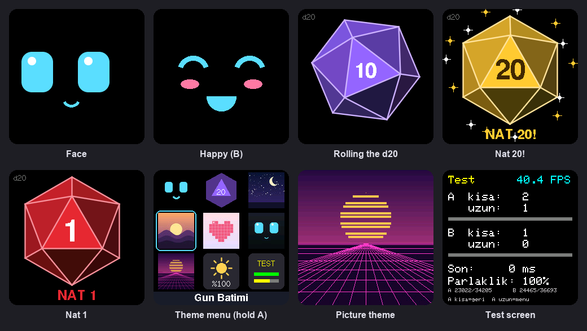

# PixelCharm

> 🚧 **Work in progress.** Phase 1 is done: the firmware runs on the real prototype. Next up: the phone app.

A tiny ESP32-S3 keychain with a 240×240 colour screen. It shows an animated face, rolls a fair d20, and plays your own pictures and GIFs. Later, a phone app will send themes to it over Bluetooth Low Energy.



<sub>Real screenshots, pulled from the device's frame buffer over USB with [`tools/screenshot.py`](tools/screenshot.py).</sub>

## What it does today

- **Animated face** that blinks, looks around and smiles when you tap B
- **A fair d20**: it spins and slows down, then a gold *NAT 20!* with sparkles or a red, head-shaking *NAT 1*. It uses the chip's hardware random number generator and passes a chi-square test ([below](#how-fair-is-the-d20))
- **Picture and GIF themes** read from a LittleFS partition on the flash
- **Theme menu**: hold A for a 3×3 grid of thumbnails, tap A to move, tap B to open
- **Remembers** the last theme and the brightness after a restart (NVS)
- **Touch buttons**: no push buttons on the prototype yet. A and B are bare wires on capacitive-touch pins.

| Touch | On a theme | In the menu |
|---|---|---|
| A short | Next theme | Next square |
| A long (≥ 1 s) | Open the menu | Close the menu |
| B short | The theme's action (roll, smile) | Open the square |

## Numbers measured on the prototype

| | |
|---|---|
| Full-screen frame rate | **39.5 FPS** (240×240 sprite, 40 MHz SPI with DMA; the bus limit is ~43) |
| JPEG picture on screen | **~115 ms**: read 10 ms + decode 80 ms + send 25 ms ([JPEGDEC](https://github.com/bitbank2/JPEGDEC); the first decoder tried took 365 ms) |
| GIF frame | **27 ms** to decode, so an 80 ms/frame GIF keeps its own timing (2.074 s loop vs 2.080 s in the file) |
| d20 fairness | χ² = 26.87 for 10,000 rolls (fair below 30.14 at 5 %, p = 0.11) |
| Long run | 30 minutes, 584 automatic theme switches, rolls and menu trips (88 of them through a 1 MB GIF): no restart, free RAM 214 KB at the start and at the end ([`tools/soak_test.py`](tools/soak_test.py)) |

## How fair is the d20?

`esp_random()` returns one of 2³² numbers, and 2³² isn't a multiple of 20. So `esp_random() % 20`, which is what Arduino's `random(20)` does, makes 1–16 a tiny bit more likely than 17–20 (modulo bias). [`rollDie()`](firmware/src/themes/dice.h) throws away the 16 values at the top that cause it and draws again (rejection sampling), so every face has exactly the same number of ways to come up.

To check it, send `t` over Serial: the board rolls 10,000 times and [`tools/dice_fairness.py`](tools/dice_fairness.py) runs a chi-square test on the counts. `--demo` shows why a small bias needs many rolls to catch: a die built from one byte with `% 20` slips through at 10,000 rolls and is caught at 100,000.

## Coming next

| Phase | Goal | Status |
|---|---|---|
| 0 | Setup | ✅ |
| 1 | Face, d20, pictures and GIFs on the device | ✅ |
| 2 | Phone app ↔ device over BLE: pick and send themes | ⬜ |
| 3 | Your own photos (crop, image styles like Game Boy and retro OLED) and 🎵 **Now Playing**: the song on your phone, with its cover and a progress bar | ⬜ |
| 4 | Battery, deep sleep and a 3D-printed case: a real keychain | ⬜ |
| 5 | Docs and release | ⬜ |

## Build one

**Parts (prototype):** an ESP32-S3-DevKitC-1 **N16R8** (16 MB flash, 8 MB PSRAM; clones work), a **1.3" 240×240 ST7789 IPS** module (7 pins, no CS) and jumper wires. Wiring: [`hardware/wiring.md`](hardware/wiring.md).

1. Open [`firmware/`](firmware/) in VS Code with the PlatformIO extension and press **Upload**. Plug the cable into the board's **COM/UART** USB port.
2. Make the sample themes (drawn by code, free to use) and put them on the board:
   ```sh
   pip install pillow pyserial
   python tools/make_sample_themes.py
   python tools/prepare_images.py themes-sample
   ```
   Then PlatformIO → *Platform* → **Upload Filesystem Image**.
3. Your own pictures go in `themes-private/` (git-ignored, so art you don't own never ends up in the repo): `python tools/prepare_images.py`, then upload the filesystem image again.

More in [`firmware/README.md`](firmware/README.md) and [`tools/README.md`](tools/README.md).

## Try it in the simulator

An early version (the animated face from Phase 1) runs in your browser on [Wokwi](https://wokwi.com/projects/478950439863111681). The current firmware needs the real board: touch pins, PSRAM and the LittleFS pictures.

## Repository layout

| Folder | Contents |
|---|---|
| [`firmware/`](firmware/) | ESP32-S3 firmware (C++, PlatformIO, Arduino, LovyanGFX) |
| [`app/`](app/) | Phone app (React Native + Expo, TypeScript), from Phase 2 |
| [`tools/`](tools/) | Python helpers: picture preparation, d20 fairness test, screenshots, long-run test |
| [`themes-sample/`](themes-sample/) | Sample themes drawn by `tools/make_sample_themes.py` |
| [`hardware/`](hardware/) | Wiring and parts |
| [`enclosure/`](enclosure/) | 3D-printable case, from Phase 4 |
| [`docs/`](docs/) | Images, and later the protocol and architecture |

## License

- **Code** (`firmware/`, `app/`, `tools/`, and the sample themes it draws): [MIT](LICENSE)
- **Enclosure, hardware and docs** (`enclosure/`, `hardware/`, `docs/`): [CC BY-NC 4.0](LICENSE-CC-BY-NC.md)

## Inspiration

Desk-buddy and robo-eyes projects shared by the maker community, such as [FluxGarage RoboEyes](https://github.com/FluxGarage/RoboEyes). PixelCharm's code is written from scratch.
